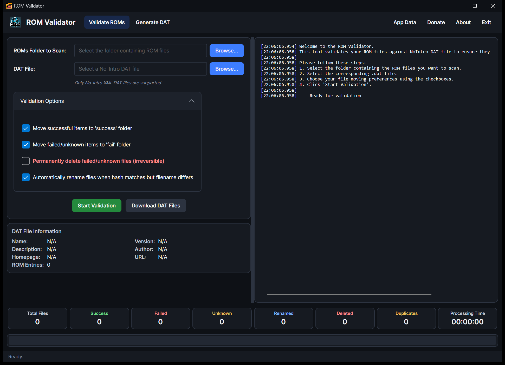
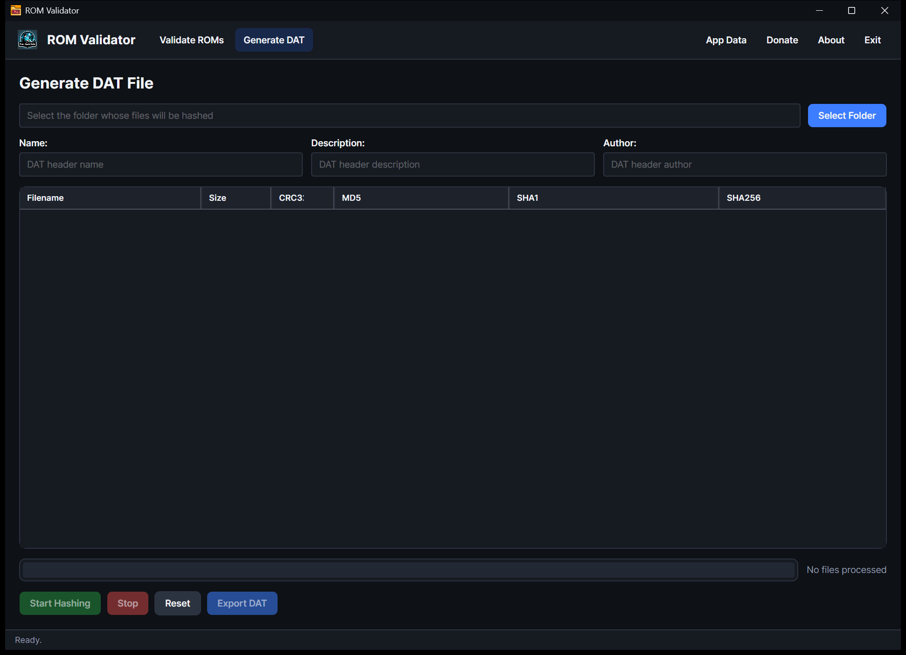

[](https://github.com/purelogiccode/RomValidator/actions/workflows/ci.yml)
[](https://github.com/purelogiccode/RomValidator/actions/workflows/docs.yml)
[](https://github.com/purelogiccode/RomValidator/releases)
[](https://github.com/purelogiccode/RomValidator/releases)
[](https://github.com/purelogiccode/RomValidator/stargazers)
[](https://github.com/purelogiccode/RomValidator/forks)
[](https://github.com/purelogiccode/RomValidator/issues)
[](https://github.com/purelogiccode/RomValidator/commits/master)
[](https://dotnet.microsoft.com/download/dotnet/11.0)
[](https://github.com/purelogiccode/RomValidator/releases)
[](LICENSE.txt)
[](docs/contributing.md)

# ROM Validator

A cross-platform desktop application for validating ROM files against DAT files and generating new No-Intro compliant DAT files from your collection. Runs on Windows, Linux and macOS.

> **Documentation:** <https://purelogiccode.github.io/RomValidator/> &nbsp;|&nbsp; **Release notes:** see [docs/release-notes.md](docs/release-notes.md)

## 📸 Screenshots





## Features

- **ROM Validation**: Validate your ROM collection against No-Intro XML DAT files
- **DAT File Generation**: Generate new No-Intro compliant DAT files from your ROM collection
- **Duplicate Detection**: Identify duplicate ROM files in your collection
- **Multiple Hash Support**: CRC32, MD5, SHA-1, and SHA-256 hash verification
- **Cross-Platform**: Windows, Linux and macOS builds on x64 and ARM64, self-contained and ready to run without a separate .NET runtime
- **Archive Support**: Read ROMs directly from `.zip`, `.7z`, and `.rar` archives (SharpCompress). The Windows bundles include `7za.exe` / `7za_arm64.exe` as a fallback; on Linux and macOS a system-installed `7zz`, `7z` or `7za` is used when available
- **Modern Dark Theme**: Avalonia 12.1 with the Fluent theme and a custom professional dark palette
- **Live Activity Log**: a full-height, resizable log panel on the right of the validation screen, with controls and DAT information on the left
- **Screenshot Capture**: Press **F8** to save a screenshot of the active window to the `Screenshot` folder next to the executable, falling back to the per-user data folder when the application folder is read-only
- **App Data Button**: the **App Data** button in the top-right corner opens the per-user data folder — logs (`Logs/`) and fallback screenshots (`Screenshot/`) live there, always writable even when the application is installed in a protected location
- **Donate Button**: the **Donate** button in the top-right corner (next to **About**) opens the [donation page](https://www.purelogiccode.com/donate) in your default browser
- **Version Checking**: Automatic GitHub version checking at startup, with a prompt to open the release page when an update is available
- **Robust Error Handling**: Retry-based temp-directory cleanup, binary-format detection for wrongly selected DAT files, and automatic bug reports (Serilog) — all Warning, Error, and Fatal events are forwarded to the bug report API

## Requirements

- **Windows 10/11, Linux or macOS 11+** on x64 or ARM64
- **No .NET runtime required** — the release bundles are self-contained
- **7-Zip** — bundled with the Windows bundles (`7za.exe` for x64, `7za_arm64.exe` for ARM64, 7-Zip 26.03); on Linux and macOS an optional system `7zz`, `7z` or `7za` enables the archive fallback

## Installation

1. Download the bundle for your platform and architecture from the [latest release](https://github.com/purelogiccode/RomValidator/releases/latest):
   - **Windows:** `release_<version>_win-x64.zip` or `release_<version>_win-arm64.zip`
   - **Linux:** `release_<version>_linux-x64.tar.gz` or `release_<version>_linux-arm64.tar.gz`
   - **macOS:** `release_<version>_osx-x64.dmg` or `release_<version>_osx-arm64.dmg`
2. Install it:
   - **Windows:** extract the zip to a permanent folder and run `RomValidator.exe`. The application refuses to run directly from a zip archive or a temporary folder.
   - **Linux:** extract the archive, make the executable startable if needed (`chmod +x RomValidator`), then run `./RomValidator`.
   - **macOS:** open the `.dmg` and drag `ROM Validator.app` to your Applications folder, then launch it from there.

Every bundle is self-contained, so no separate runtime needs to be installed. Windows bundles also include the 7-Zip fallback executables, and every bundle contains `LICENSE.txt`, `ReadMe.md` and `WhatsNew.md`.

Full instructions: [Getting Started](docs/getting-started.md).

## Documentation

The complete documentation lives in the [`docs/`](docs) folder and is published to:

- **Documentation site:** <https://purelogiccode.github.io/RomValidator/>
- **GitHub Wiki:** <https://github.com/purelogiccode/RomValidator/wiki>

| Section | Contents |
|:--------|:---------|
| [Getting Started](docs/getting-started.md) | Install, first run, quick start |
| [User Guide](docs/user-guide.md) | Validation, DAT generation, duplicates, archives, data |
| [Reference](docs/reference.md) | Formats, troubleshooting, build, architecture, CI/CD |
| [FAQ](docs/faq.md) | Frequently asked questions |
| [Contributing](docs/contributing.md) | Bugs, features, pull requests |

## Usage

### Validating ROMs
1. Launch the application
2. Navigate to the "Validate ROMs" tab
3. Load a DAT file (No-Intro format, `.dat` or `.xml`)
4. Select your ROM directory or archive
5. Click "Start Validation" to begin
6. Review the results: matched, failed, unknown, renamed, and duplicate files, with live progress stats

### Generating DAT Files
1. Navigate to the "Generate DAT" tab
2. Select your ROM directory
3. Configure output settings (name, description, author)
4. Click "Start Hashing" to compute hashes, then "Export DAT"
5. Save the generated DAT file for use with other ROM management tools

### Tips
- Use **F8** anytime to capture a screenshot of the active window.
- Click **App Data** (top-right, next to About) to open the folder where logs and fallback screenshots are stored.
- DAT files must be No-Intro XML; ZIP archives, binary images, and ClrMamePro/MAME formats are detected and rejected with a clear message.
- If a file is temporarily locked (e.g. still being written), the app retries automatically and cleans up leftover temp folders in the background.

## Data locations

Logs (`Logs/`) and fallback screenshots (`Screenshot/`) live in a per-user data folder:

| Platform | Folder |
|:---------|:-------|
| Windows | `%LOCALAPPDATA%\ROM Validator` |
| macOS | `~/Library/Application Support/ROM Validator` |
| Linux | `~/.local/share/ROM Validator` (the XDG data directory when set) |

Primary screenshots are written to the `Screenshot` folder next to the executable when that folder is writable. See [Screenshots and Application Data](docs/screenshots-and-data.md).

## Dependencies

- **Avalonia** (12.1.6): cross-platform UI framework, Fluent theme, Inter font and DataGrid
- **Serilog** (4.4.0) + Sinks (Debug, File): structured logging and automatic bug reports
- **SharpCompress** (0.50.9): zip/7z/RAR archive reading and zip/7z archive creation
- **7-Zip 26.03** (`7za.exe` / `7za_arm64.exe`): bundled fallback in the Windows bundles; a system `7zz`, `7z` or `7za` is used on Linux and macOS when present
- **xUnit** (2.9.3), **Microsoft.NET.Test.Sdk** (18.12.0), **coverlet.collector** (10.1.0): testing

## Tests

The solution includes unit and integration tests (models, services, hash calculation, archive handling, temp-directory cleanup, serialization). Run them with:

```
dotnet test
```

The suite runs on Windows, Linux and macOS; CI executes it on all three platforms.

## Continuous Integration

| Workflow | Purpose |
|:---------|:--------|
| [CI](.github/workflows/ci.yml) | Builds and tests on `windows-latest`, `ubuntu-latest` and `macos-latest`, and runs JetBrains InspectCode with zero findings |
| [Release](.github/workflows/release.yml) | Runs the test suite, then publishes self-contained win-x64/win-arm64 zips, linux-x64/linux-arm64 tar.gz bundles and osx-x64/osx-arm64 dmgs (with license, readme and what's new) plus checksums on `release_*` / `v*` tags, with generated release notes |
| [Docs](.github/workflows/docs.yml) | Publishes the documentation site and mirrors `docs/` to the wiki |

See [CI/CD](docs/ci-cd.md) for details.

## What's New

See [WhatsNew.md](WhatsNew.md) for the latest release highlights and [Release Notes](docs/release-notes.md) for the full history.

## Acknowledgments

- No-Intro for the DAT file format specification
- [Avalonia](https://avaloniaui.net/) for the cross-platform user interface
- SharpCompress for archive support
- 7-Zip for the standalone fallback executables

## Contributing & Support

* **Donate:** If you find this project useful, consider [supporting the developer](https://www.purelogiccode.com/donate).
* **If you like this project, please give us a star on GitHub! ⭐**

## 📜 License

This project is licensed under the GPLv3 License – see the [LICENSE](LICENSE.txt) file for details.

Copyright (C) 2026 [Peterson Fernandes](https://github.com/drpetersonfernandes) – [PureLogicCode.com](https://www.purelogiccode.com)
